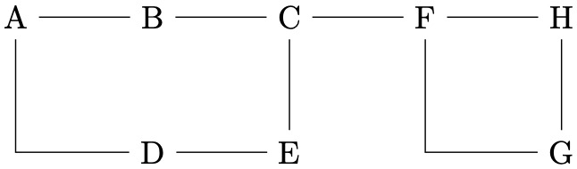
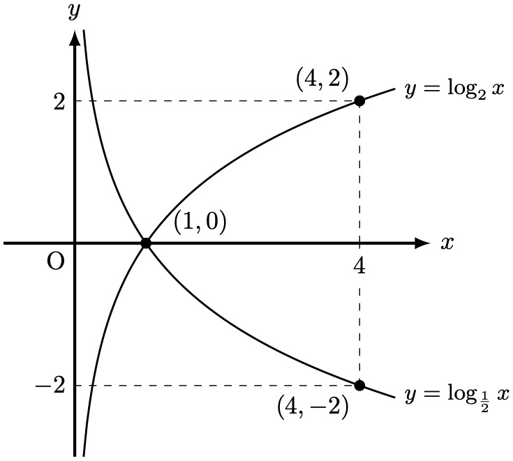
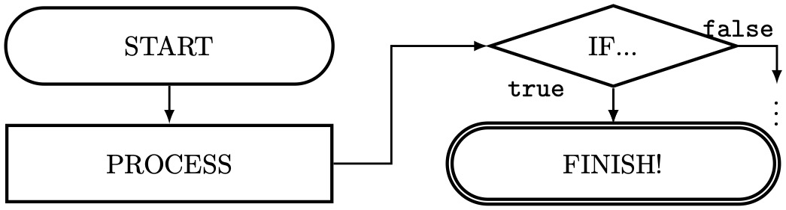
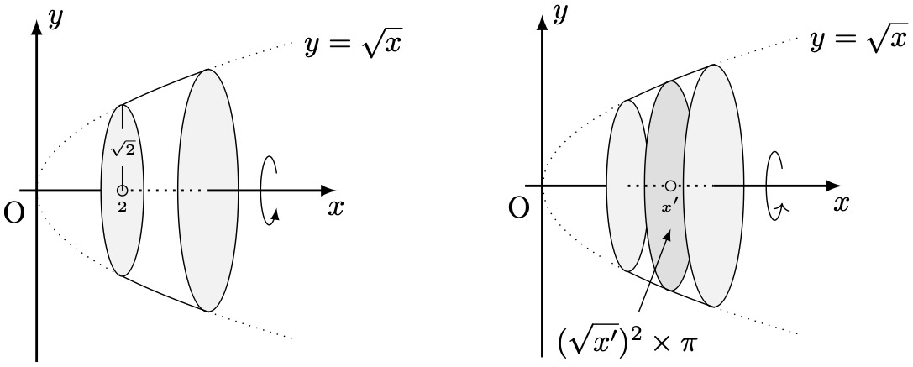

# 軽く自己紹介
みなさん，こんにちは．
総合研究大学院大学情報学コースD1の[溝口](https://orcid.org/0009-0000-7902-2760)(age: 23)です．
所属基盤機関は国立情報学研究所です．
研究は情報セキュリティで主に認証・鍵交換の規格をIoT機器向けに軽量化する研究を行っております．
趣味はいろいろありますが，音楽が好きでピアノもドラムも十数年やってます (一応今は市民楽団で活動しています)．

時間講師という立場ですが，都立高校で数学の教員としても働いています．
また，$\LaTeX$好きが高じてアカリクのCloudLaTeXのサポータとしても(ちょっとだけ)働いています．[[1]](https://cloudlatex.io/events/10?utm_source=cloudlatex_site&utm_medium=banner&utm_campaign=20250130Launch)

# 本記事の目的
本日はアドカレで何を書こうか散々悩んで，結局$\LaTeX$ネタになりました．
知っている人からすると完全に釈迦に説法なので，SkipしていただいてOKです．

みなさん，文書作成に欠かせない (多分言い過ぎ) $\LaTeX$ はご存知でしょうか．
理系の方なら「聞いたことはあるなぁ」って人から「毎日使っているぜ」人まで，幅広いと思います．

$\LaTeX$ が何たるかはここでは詳しく説明しませんが，文書の元となるソースコードをコンパイルして PDF を生成する仕組み，くらいの理解で大丈夫です．

さて，文書には図を挿入することがありますよね．
Word や Pages では、「挿入」ボタンから画像ファイルを選ぶだけで簡単に貼れますし，マウスとキーボードでポンチ絵を直接描くこともできます．

一方 $\LaTeX$ では、PowerPoint や draw.io などで図を作成して画像として書き出し，たとえば次のようにして挿入するのが一般的です．
```tex
\includegraphics[option]{path/to/figure}
```
しかし，図に修正が入るたびに 元ファイル (`.pptx`など) を編集 → 画像として再書き出し → 差し替え ...という手順が必要になり，地味に手間がかかります．さらには，PowerPointでのフォントと$\LaTeX$ドキュメントのフォントが異なれば，見栄えも....
さらには，JPEG/PNGで書き出していると，拡大時に画像が荒くなりますよね (ラスタ)．
できればベクタ画像がよいですよね．

そこで本記事では TikZ を紹介します．
TikZ は $\LaTeX$ のソース内で図を描くためのツールで，`\includegraphics` に頼らずに図の描画・編集ができます．TikZ を習得すると、図の修正を含めた文書作成がより効率的になり，文書が美しくなります (完全に主観)．

# TikZとは？？
TikZは，LaTeXのソースコード内で図や図形を描画できるパッケージです．
画像を書き出して貼るのではなく， 線・矢印・図形・文字，グラフなどをコードで直接記述します．
そのため，図の修正はソースを直すだけで済み，PDF生成のたびに自動で反映されます．
座標指定や相対配置，スタイルの再利用ができるので，図の見た目を統一しやすく，Gitで差分管理しやすいため，論文やスライドの図を再現性高く・効率よく作れます．

## TikZの基本
TikZは `\begin{tikzpicture} \end{tikzpicture}`の環境の中に，図をコードで書く，これが出発点です．

(厳密には間違いですが)TikZには，大きく2つの操作：
- `\node`：文字やラベルを置く
	```tex
	\node(node_name) [option] at(x,y) {Label};
	```
- `\draw`：線を引く
	```tex
	\draw[option] (x1,y1) -- (x2,y2);
	```

があります．これらを使い分けて図を完成させていきます．
また，線や文字の座標指定方法は「絶対座標」と「相対座標」の2つがあり，それらを組み合わせて図を作っていきます．

## 無向グラフを書いてみよう
以下のような無向グラフをTikZで書いてみる．
```
A--B--C--F--H
|     |  |  |
`--D--E  `--G
```
1. ここで，`A`を固定し，`A`から右に1cmのところに`B`を，さらに右に1cmのところに`C`を...と，`H`まで設置したら，
1. `D`を`B`の1cm下に設置する．
1. `D`からの水平な線と`C`からの垂直な線の交点に`E`を設置
1. `D`からの水平な線と`H`からの垂直な線の好転に`G`を設置 (これにより`B--D`の間隔が変わっても`C--E`・`H--G`の間隔もそれに伴い変わる)
1. 最後に辺を描く
```tex
\documentclass{article}
\usepackage{tikz}
\usetikzlibrary{positioning}
\begin{document}
\begin{tikzpicture}
	\node(nodeA) at (0,0) {A}; % at (0,0)は，書かなくても良い
	\node(nodeB) [right=1cm of nodeA] {B}; % 相対座標「nodeAの1cm右」
	\node(nodeC) [right=1cm of nodeB] {C};
	\node(nodeF) [right=1cm of nodeC] {F};
	\node(nodeH) [right=1cm of nodeF] {H};

	\node(nodeD) [below=1cm of nodeB] {D};
	\node(nodeE) at (nodeD-|nodeC) {E}; % nodeDのy座標とnodeCのx座標
	\node(nodeG) at (nodeD-|nodeH) {G};

	\draw (nodeA)--(nodeB); \draw (nodeB)--(nodeC); \draw (nodeC)--(nodeF);
	\draw (nodeF)--(nodeH); 
	\draw (nodeA)|-(nodeD); % 直角に曲がる線
	\draw (nodeD)--(nodeE);
	\draw (nodeF)|-(nodeG);
	\draw (nodeE)--(nodeC);
	\draw (nodeG)--(nodeH);
\end{tikzpicture}
\end{document}
```
```bash
$ pdflatex main.tex
```

:::message
- 線の太さや尖端の形状は`[option]`で変更できる．
- Nodeの形状は`[option]`で変更できる．
:::

## 関数グラフを書いてみよう
$y=\log_2x$のグラフと$y=\log_\frac{1}{2}x$のグラフを同じ座標平面上に書きたい．
TikZでは，`plot`というもので関数グラフを作成できる．
```tex
% 定義域をdomainで
% smooth  : 滑らかな曲線（スプライン曲線）で補完
% samples : サンプル数
\draw[domain=x1:x2,smooth,samples=100] plot(\x,{func(\x)}) node[<position>]{label};
```
```tex
\documentclass{article}
\usepackage{tikz}
\usetikzlibrary{positioning,calc,arrows.meta}
\begin{document}
\begin{tikzpicture}
	% very thick(結構太い), -latex(尖端矢印), (3,0)node[right]{...} (3,0)の右に"x"とラベリング
	\draw[very thick,-latex] (-1,0)--(5,0)node[right]{\(x\)};
	\draw[very thick,-latex] (0,-3)--(0,3)node[above]{\(y\)};
	\node[below left] at (0,0) {\(\mathrm{O}\)}; % 原点に"O"とラベリング

	\draw[thick,domain={1/8}:4.5,smooth,samples=100] plot(\x,{ln(\x)/ln(2)})node[right]{\small \(y=\log_2 x\)};
	\draw[thick,domain={1/8}:4.5,smooth,samples=100] plot(\x,{ln(\x)/ln(1/2)})node[right]{\small \(y=\log_{\frac{1}{2}} x\)};
	
	% (4,0)--(4,-2)--(0,-2)に破線，(0,-2)の左側に"-2"とラベリング
	\draw[dashed](4,0)--(4,-2)--(0,-2)node[left]{\(-2\)};
	% (4,0)--(4,2)--(0,2)に破線，(0,2)の左側に"2"とラベリング，(4,0)の下側に，白背景で"4"とラベリング
	\draw[dashed](4,0)node[below=2pt,fill=white]{\(4\)}--(4,2)--(0,2)node[left]{\(2\)};
	
	% (1,0), (4,2), (4,-2)に半径2ptの黒丸を描き，またそれぞれラベルを打つ
	\draw[fill](1,0)circle[radius=2pt]node[above right,xshift=.25cm]{\((1,0)\)};
	\draw[fill=black](4,2)circle[radius=2pt]node[above left]{\((4,2)\)};
	\draw[fill=black](4,-2)circle[radius=2pt]node[below left]{\((4,-2)\)};
\end{tikzpicture}
\end{document}
```


## フローチャートを描いてみよう
矢印の少しのずれも気に入らないそこのあなた，フローチャートはTikZで書きましょう．
マウスで誤って矢印をずらしてしまった💦など起こりません．

Nodeは`[option]`でNodeの形状を変更できます．

```tex
\node[rounded rectangle] {}; % 角が丸い四角
\node[diamond] {}; % ダイヤモンド
```
また，Node間の中点など，新たな座標を計算してもらって名前をつけることができます．
```tex
% nodeA と nodeB の中点を mid と名づける
\coordinate (mid) at ($(nodeA)!0.5!(nodeB)$);
```

```tex
\documentclass{article}
\usepackage{tikz}
\usetikzlibrary{positioning,calc,arrows.meta,shapes.misc,shapes.geometric}
\begin{document}
\begin{tikzpicture}
      \node[align=center,draw,very thick,rounded rectangle,text width=4cm,minimum height=1cm](st){START};
      \node[align=center,draw,very thick,rectangle,text width=4cm,minimum height=1cm,below=.5cm of st](p){PROCESS};
      \node[align=center,draw,very thick,diamond,minimum height=1cm,right=2cm of st,diamond,inner sep=0pt,aspect=3,text width=2.5cm](d){IF...};
      \node[align=center,draw,very thick,rounded rectangle,text width=4cm,minimum height=1cm,double]at (d|-p)(end){FINISH!};
      \draw[-latex,thick](st) -- (p);
      \coordinate (mid) at ($(p)!0.5!(end)$);
      \draw[-latex,thick](p.east)-|(mid)|-(d.west);
      \draw[-latex,thick](d.south)--(end.north);
      \draw[-latex,thick](d.south)node[left=.5cm]{\texttt{true}}--(end.north);
      \draw[-latex,thick](d.east)node[above]{\texttt{false}}--++(.5,0)--++(0,-.5)node[below,inner sep=0pt]{\vdots};
\end{tikzpicture}
\end{document}
```


## 頑張ったら回転体などもかける
高校数IIIで出てくる「回転体」ですが，これもTikZで描けます．
ちょっとコードの解説は大変なので，ソースコードと期待する出力だけ貼っておきます．

```tex
\documentclass{article}
\usepackage{tikz}
\usetikzlibrary{positioning,calc,arrows.meta}
\begin{document}
\begin{minipage}{.48\textwidth}
      \centering
      \begin{tikzpicture}[samples=300]
        \def\Fx{plot(\x,{sqrt(\x)})}
        \def\dFx{plot(\x,{-1*sqrt(\x)})}
        \filldraw[draw,fill=gray!10](2,0)ellipse({sqrt(2)/4} and {sqrt(2)});
        \filldraw[draw,fill=gray!10](1,0)ellipse({sqrt(1)/4} and {sqrt(1)});
        \draw[domain=1:2] \Fx \dFx;
        \draw[domain=2:3,dotted] \Fx node[right]{\(y=\sqrt{x}\)} \dFx;
        \draw[domain=0:1,dotted] \Fx \dFx;
        \draw[thick](-0.2,0)--(0.75,0);
        \draw[thick,dotted](1,0)--(2,0);
        \draw[-latex,thick](2,0)--(3.5,0)node[below]{\(x\)};
        \draw[-latex,thick](0,-2)--(0,2)node[right]{\(y\)};
        \node[below left] at (0,0){\(\mathrm{O}\)};
        \draw[-latex](2.8,0.2)arc[start angle=30, end angle=330, x radius=0.1, y radius=0.4];
        \node at (1,1/2)(r){\tiny \(\sqrt{2}\)};
        \draw[thin,fill=gray!20](1,0)circle[radius=0.06]node[below]{\tiny \(2\)}--(r)--(1,1);
      \end{tikzpicture}
    \end{minipage}
    \begin{minipage}{.48\textwidth}
      \centering
      \begin{tikzpicture}
        \def\Fx{plot(\x,{sqrt(\x)})}
        \def\dFx{plot(\x,{-1*sqrt(\x)})}
        \filldraw[draw,fill=gray!10](1,0)ellipse({sqrt(1)/4} and {sqrt(1)});
        \filldraw[draw,fill=gray!25](1.5,0)ellipse({sqrt(1.5)/4} and {sqrt(1.5)});
        \filldraw[draw,fill=gray!10](2,0)ellipse({sqrt(2)/4} and {sqrt(2)});
        \draw[domain=1:2] \Fx \dFx;
        \draw[domain=2:3,dotted] \Fx node[right]{\(y=\sqrt{x}\)} \dFx;
        \draw[domain=0:1,dotted] \Fx \dFx;
        \draw[thick](-0.2,0)--(0.75,0);
        \draw[thick,dotted](1,0)--(2,0);
        \draw[-latex,thick](2,0)--(3.5,0)node[below]{\(x\)};
        \draw[-latex,thick](0,-2)--(0,2)node[right]{\(y\)};
        \node[below left] at (0,0){\(\mathrm{O}\)};
        \draw[->](2.8,0.2)arc[start angle=30, end angle=330, x radius=0.1, y radius=0.4];
        \draw[fill=gray!20](1.5,0)circle[radius=0.06]node[below]{\tiny \(x'\)};
        \node at (1,-1.8)(s) {\((\sqrt{x'})^2\times \pi\)};
        \draw[-latex](s)--(1.5,-0.5);
      \end{tikzpicture}
\end{minipage}
\end{document}
```


# 最後に
TikZは本当に色々なことができる万能なパッケージです．
[TikZのマニュアル](https://jp.mirrors.cicku.me/ctan/graphics/pgf/base/doc/generic/pgf/pgfmanual.pdf)は1,300頁以上あります([web manual is also available](https://tikz.dev))あり，一から読み込まずとも，辞書代わりとして使えばOKだと思います．わからないことがあれば，[TeXStackExchange](https://tex.stackexchange.com)で訊くと誰かが答えてくれます．

綺麗な綺麗な図を効率良く書くことが目的だと言いましたが，正直習得にはかなりの時間が必要です．
使いながら慣れるしかないと思いますが，手に馴染むとマウスを使った製図が嫌になるくらい使いやすいです．
これを機にTikZに慣れ親しんでくださると嬉しいです．

なんかまとまりのないブログになってしまいましたが，最後まで読んでいただきありがとうございました．